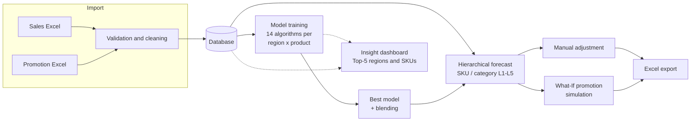

# Demand Forecast System

**Self-hosted demand forecasting for sales teams.** Upload sales and promotion data from Excel,
train 14 time-series models per *region × product*, get multi-month forecasts you can adjust by
hand, and simulate promotion scenarios before you commit to them.

[](https://github.com/OWNER/REPO/actions/workflows/ci.yml)
[](LICENSE)
[](https://www.python.org/)
[](https://www.djangoproject.com/)
[](docs/en/i18n.md)
[](CONTRIBUTING.md)

**English** | [简体中文](README.zh-CN.md)

> ⭐ **If this project is useful to you, a star helps other people find it.**

| | | | |
| :---: | :---: | :---: | :---: |
| **14** forecasting algorithms | **5** category levels | **6** interface languages | **0** cloud dependency |

---

## Table of contents

- [Why this project](#why-this-project)
- [How it works](#how-it-works)
- [Features](#features)
- [Tech stack](#tech-stack)
- [Quick start](#quick-start)
- [Preparing your data](#preparing-your-data)
- [Trying it with sample data](#trying-it-with-sample-data)
- [Documentation](#documentation)
- [Project layout](#project-layout)
- [Roadmap / known limitations](#roadmap--known-limitations)
- [Contributing](#contributing)
- [License](#license)

## Why this project

Most small and mid-sized sales teams still forecast demand in a spreadsheet: one tab per product,
a hand-tuned seasonal factor, no backtesting, and no way to answer *"what happens if we double the
promotion in March?"*

This project packages the whole loop into one application you can run yourself:

* **No SaaS, no data upload to a third party** — your sales figures stay on your own server.
* **One database, one command** — SQLite by default, no infrastructure to provision.
* **Model competition instead of guesswork** — every candidate model is scored with MASE on a
  hold-out window and overfitted candidates are retried with simpler parameters.
* **Explainable promotion impact** — elasticity is estimated from your own promotion history and
  shown next to the formula, so a planner can sanity-check it.

Typical users: demand planners, S&OP analysts, category managers, and developers who need a
forecasting backend they can extend rather than a black-box API.

## How it works



## Features

| Module | What it does |
| --- | --- |
| **Data Management** (`/data/`) | Upload sales / promotion Excel files, browse, filter, edit and export the stored data, download import templates |
| **Data Insight** (`/insight/`) | Interactive dashboard: Top-5 regions and SKUs, monthly / quarterly / yearly sales trends |
| **Model Training** (`/model/`) | Train 14 algorithms per region × product combination, keep the best one, auto-recover from overfitting |
| **Demand Forecast** (`/forecast/`) | Run forecasts with the auto-matched or a manually selected model, manually adjust values, export to Excel |
| **What-If Analysis** (`/forecast/what-if/`) | Simulate the sales impact of a promotion change using promotion elasticity |

Additional highlights

* **14 forecasting algorithms** — Holt-Winters, ARIMA, ARIMAX, XGBoost, Prophet,
  Random Forest, moving / weighted average, exponential smoothing, seasonal
  naive, Croston, SBA, LSTM and DeepAR. Optional algorithms activate
  automatically once their dependency is installed.
* **Automatic model selection** — every candidate is trained, overfitted models
  are retried with simpler parameters, the best is kept and models are blended.
* **Hierarchical forecasting** — forecast at SKU level or at any of five product
  category levels, with automatic SKU-level fallback.
* **Promotion elasticity** — elasticity is derived from history and can be
  overridden for What-If simulations.
* **Multilingual UI** — English (default), 中文, Français, Deutsch, Español and
  日本語. Each language is listed under its own name in the switcher at the top
  right, and dates are localised as well (`2025年1月15日`, `Jan. 15, 2025`,
  `15 janvier 2025`, …). See [docs/en/i18n.md](docs/en/i18n.md).
* **Batteries-included front end** — Bootstrap 5 + Chart.js, no build step, no
  Node toolchain, works offline.

## Tech stack

* Python 3.10+ (tested on 3.13) and Django 4.2+ (tested on 4.2.7 and 6.1)
* pandas / numpy for data handling, scikit-learn and XGBoost for ML models
* Bootstrap 5 + Chart.js front end, SQLite by default (any Django database works)

## Quick start

Five minutes from clone to a running instance:

```bash
git clone https://github.com/OWNER/REPO.git demand_forecast
cd demand_forecast

python -m venv .venv
source .venv/bin/activate            # Windows: .venv\Scripts\activate
pip install -r requirements.txt

cp .env.example .env                 # optional, then edit DJANGO_SECRET_KEY

python manage.py migrate
python manage.py compilemessages     # builds the translation catalogs
python manage.py createsuperuser
python manage.py runserver
```

Open <http://127.0.0.1:8000/> and log in. Detailed instructions, including
production deployment notes, are in
[docs/en/installation.md](docs/en/installation.md).

> `compilemessages` requires GNU gettext (`brew install gettext` on macOS,
> `apt-get install gettext` on Debian/Ubuntu). Without it the UI falls back to
> the source strings (Simplified Chinese).

## Preparing your data

Two Excel files can be uploaded, and templates for both are downloadable from
the Data Management page:

| File | Required columns |
| --- | --- |
| Sales data | `销售区域代码`, `销售区域名称`, `产品一级分类` … `产品五级分类`, `物料号`, `物料名称`, `日期` (`YYYY-MM-DD`), `销量` |
| Promotion data | the same region / product columns plus `日期`, `促销力度`, `促销开始日期`, `促销结束日期` |

`销量` and `促销力度` must be numeric; `物料号` and `销售区域代码` must match
the values already stored in the system.

## Trying it with sample data

**No customer data is committed to this repository.** Generate a synthetic
dataset with one command and upload the two files from the Data Management page:

```bash
python scripts/generate_sample_data.py                      # 3 regions x 9 SKUs x 36 months
python scripts/generate_sample_data.py --months 48 --start 2019-01 --seed 7
```

The output is deterministic for a given `--seed`, which makes screenshots and
bug reports reproducible. The generated series contain a trend, monthly
seasonality, promotion spikes and noise, so model training, model selection and
the What-If simulation behave exactly like they do on real data.

## Documentation

| Document | Content |
| --- | --- |
| [Installation](docs/en/installation.md) | Requirements, setup, configuration, deployment |
| [Usage guide](docs/en/usage.md) | End-to-end walkthrough of every module |
| [Architecture](docs/en/architecture.md) | Apps, data model, algorithms, endpoints |
| [Translations](docs/en/i18n.md) | How the multilingual UI works, how to add a language |
| [Contributing](CONTRIBUTING.md) | Development workflow, coding and i18n rules |
| [Security](SECURITY.md) | Reporting a vulnerability, hardening notes |
| [Changelog](CHANGELOG.md) | Release history |

Chinese versions: [安装](docs/zh/installation.md) ·
[使用](docs/zh/usage.md) · [架构](docs/zh/architecture.md) ·
[多语言](docs/zh/i18n.md) · [贡献](CONTRIBUTING.zh-CN.md) ·
[安全](SECURITY.zh-CN.md) · [更新日志](CHANGELOG.zh-CN.md)

## Project layout

```
demand_forecast/
├── config/                 # Django project (settings, urls, wsgi, asgi)
├── apps/
│   ├── core/               # Home page, middleware, system log model
│   ├── data_management/    # Excel upload, browse, edit, export
│   ├── data_insight/       # Analytics dashboard
│   ├── model_training/     # Training engine and 14 algorithms
│   ├── demand_prediction/  # Forecasting, manual adjustment, What-If
│   └── user_management/    # Login / registration / dashboard
├── locale/                 # en + zh_Hans + fr + de + es + ja catalogs
├── templates/              # Base template and shared includes
├── static/                 # CSS and JS
├── TestData/               # Sample Excel files (generated, not committed)
└── docs/                   # Documentation (en / zh)
```

## Roadmap / known limitations

Honest about what is not finished yet — issues and PRs are welcome on all of them:

* `user_management` is a placeholder: registration, dashboard and permission
  pages render but do not implement full account management yet.
* `SystemLog` is defined but not written to anywhere yet.
* The forecasting code lives in `apps/model_training/views.py`; splitting it
  into a service layer is planned.
* LSTM and DeepAR are reference implementations rather than tuned models.
* No Docker image yet.

## Contributing

Contributions of every size are welcome — bug reports, data-format edge cases,
new algorithms, translations, documentation fixes.

1. Read [CONTRIBUTING.md](CONTRIBUTING.md).
2. Open an issue describing the problem or the idea.
3. Send a pull request; CI runs system checks and the test suite on Python
   3.11 / 3.12 / 3.13.

Not sure where to start? Look for issues labelled `good first issue` or improve a
translation in `locale/`.

## License

Released under the [MIT License](LICENSE).

---

⭐ **Found this useful? Star the repository** — it helps other planners and
developers discover the project.
