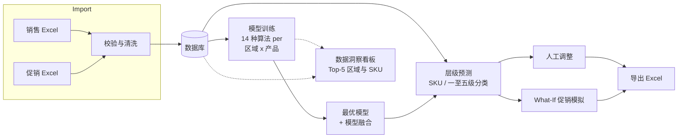

# 需求预测系统 Demand Forecast System

**面向销售团队的自托管需求预测系统。** 从 Excel 导入销量与促销数据，按「区域 × 产品」自动训练
14 种时序模型，生成未来多月的预测结果，可人工调整，并能在真正投入促销之前做 *What-If* 模拟。

[](https://github.com/OWNER/REPO/actions/workflows/ci.yml)
[](LICENSE)
[](https://www.python.org/)
[](https://www.djangoproject.com/)
[](docs/zh/i18n.md)
[](CONTRIBUTING.zh-CN.md)

[English](README.md) | **简体中文**

> ⭐ **如果这个项目对你有帮助，欢迎点个 Star，让更多人发现它。**

| | | | |
| :---: | :---: | :---: | :---: |
| **14** 种预测算法 | **5** 级产品分类 | **6** 种界面语言 | **0** 云服务依赖 |

---

## 目录

- [为什么做这个项目](#为什么做这个项目)
- [整体流程](#整体流程)
- [功能一览](#功能一览)
- [技术栈](#技术栈)
- [快速开始](#快速开始)
- [数据准备](#数据准备)
- [用示例数据快速体验](#用示例数据快速体验)
- [文档](#文档)
- [目录结构](#目录结构)
- [已知限制与后续计划](#已知限制与后续计划)
- [参与贡献](#参与贡献)
- [许可证](#许可证)

## 为什么做这个项目

大量中小销售团队仍在 Excel 里做需求预测：一个产品一个工作表、季节系数靠手工调、没有回测，
更没法回答「三月促销力度翻倍会怎样」。

本项目把整条链路打包成一个可自托管的应用：

* **不上云、不交数据** —— 销量数据只留在你自己的服务器上。
* **一个数据库、一条命令** —— 默认 SQLite，不需要搭建额外基础设施。
* **让模型竞争，而不是靠猜** —— 每个候选模型都在留出窗口上用 MASE 打分，
  过拟合的候选会降复杂度重试，最终保留最优并做融合。
* **可解释的促销影响** —— 弹性系数由你自己的促销历史估算，界面同时给出计算公式，
  业务人员能自行校验。

典型使用者：需求计划员、S&OP 分析师、品类经理，以及需要一个可扩展预测后端（而不是黑盒 API）
的开发者。

## 整体流程



## 功能一览

| 模块 | 说明 |
| --- | --- |
| **数据管理** (`/data/`) | 上传销售/促销 Excel、浏览筛选、编辑调整、导出数据、下载导入模板 |
| **数据洞察** (`/insight/`) | 交互看板：Top-5 区域与 SKU、按年/季/月/周的销量趋势 |
| **模型训练** (`/model/`) | 按「区域 × 产品」组合训练 14 种算法，自动淘汰过拟合模型并保留最优 |
| **需求预测** (`/forecast/`) | 自动匹配或手动指定模型执行预测，支持人工调整与 Excel 导出 |
| **What-If 分析** (`/forecast/what-if/`) | 基于促销弹性系数模拟促销力度变化对销量的影响 |

其他特性

* **14 种预测算法** —— Holt-Winters、ARIMA、ARIMAX、XGBoost、Prophet、随机森林、
  移动平均、加权平均、指数平滑、季节朴素法、Croston、SBA、LSTM、DeepAR。
  可选算法只要装上依赖就会自动出现在列表中。
* **自动选模** —— 逐算法训练，命中过拟合则降复杂度重试，最终保留最优模型并做融合。
* **层级预测** —— 支持 SKU 级与五级产品分类级预测，并在 SKU 级之间自动回退。
* **促销弹性** —— 从历史数据自动计算弹性系数，也支持手动覆盖。
* **多语言界面** —— 默认英文，另有中文、Français、Deutsch、Español、日本語。
  右上角切换器中每种语言都以自身名称显示，日期同样本地化（`2025年1月15日`、
  `Jan. 15, 2025`、`15 janvier 2025` 等）。详见 [docs/zh/i18n.md](docs/zh/i18n.md)。
* **开箱即用的前端** —— Bootstrap 5 + Chart.js，无需 Node 构建，可离线运行。

## 技术栈

* Python 3.10+（已在 3.13 验证）、Django 4.2+（已在 4.2.7 与 6.1 验证）
* pandas / numpy 处理数据，scikit-learn 与 XGBoost 提供机器学习模型
* 前端 Bootstrap 5 + Chart.js，默认 SQLite（可换成任意 Django 支持的数据库）

## 快速开始

从 clone 到跑起来约五分钟：

```bash
git clone https://github.com/OWNER/REPO.git demand_forecast
cd demand_forecast

python -m venv .venv
source .venv/bin/activate            # Windows: .venv\Scripts\activate
pip install -r requirements.txt

cp .env.example .env                 # 可选，记得修改 DJANGO_SECRET_KEY

python manage.py migrate
python manage.py compilemessages     # 编译翻译文件
python manage.py createsuperuser
python manage.py runserver
```

访问 <http://127.0.0.1:8000/> 登录即可。完整的安装与部署说明见
[docs/zh/installation.md](docs/zh/installation.md)。

> `compilemessages` 依赖 GNU gettext（macOS：`brew install gettext`；
> Debian/Ubuntu：`apt-get install gettext`）。未编译翻译时界面会回退到源语言（简体中文）。

## 数据准备

系统支持上传两类 Excel，模板可在「数据管理」页面直接下载：

| 文件 | 必需列 |
| --- | --- |
| 销售数据 | `销售区域代码`、`销售区域名称`、`产品一级分类` … `产品五级分类`、`物料号`、`物料名称`、`日期`（`YYYY-MM-DD`）、`销量` |
| 促销数据 | 同样的区域/产品列，另加 `日期`、`促销力度`、`促销开始日期`、`促销结束日期` |

`销量` 与 `促销力度` 必须是数字，`物料号`、`销售区域代码` 需与系统中已有数据一致。

## 用示例数据快速体验

**本仓库不包含任何客户数据。** 一条命令即可生成脱敏的合成数据集，
再到「数据管理」页上传两个文件：

```bash
python scripts/generate_sample_data.py                      # 3 个区域 x 9 个 SKU x 36 个月
python scripts/generate_sample_data.py --months 48 --start 2019-01 --seed 7
```

相同 `--seed` 会生成完全相同的数据，方便复现截图与缺陷报告。
生成序列包含趋势、月度季节性、促销脉冲与随机噪声，
因此模型训练、自动选模与 What-If 模拟的表现与真实数据一致。

## 文档

| 文档 | 内容 |
| --- | --- |
| [安装部署](docs/zh/installation.md) | 环境要求、安装步骤、配置项、生产部署 |
| [使用指南](docs/zh/usage.md) | 各模块的完整操作流程 |
| [架构说明](docs/zh/architecture.md) | 应用划分、数据模型、算法与接口 |
| [多语言](docs/zh/i18n.md) | 多语言界面的实现方式与新增语言的方法 |
| [贡献指南](CONTRIBUTING.zh-CN.md) | 开发流程、代码与翻译规范 |
| [安全策略](SECURITY.zh-CN.md) | 漏洞报告与安全加固建议 |
| [更新日志](CHANGELOG.zh-CN.md) | 版本记录 |

English versions: [Installation](docs/en/installation.md) ·
[Usage](docs/en/usage.md) · [Architecture](docs/en/architecture.md) ·
[Translations](docs/en/i18n.md) · [Contributing](CONTRIBUTING.md) ·
[Security](SECURITY.md) · [Changelog](CHANGELOG.md)

## 目录结构

```
demand_forecast/
├── config/                 # Django 工程配置（settings、urls、wsgi、asgi）
├── apps/
│   ├── core/               # 首页、中间件、系统日志模型
│   ├── data_management/    # Excel 上传、浏览、编辑、导出
│   ├── data_insight/       # 数据分析看板
│   ├── model_training/     # 训练引擎与 14 种算法
│   ├── demand_prediction/  # 预测执行、人工调整、What-If
│   └── user_management/    # 登录 / 注册 / 仪表盘
├── locale/                 # en、zh_Hans、fr、de、es、ja 翻译目录
├── templates/              # 基础模板与公共片段
├── static/                 # CSS 与 JS
├── TestData/               # 示例 Excel 数据（脚本生成，不入库）
└── docs/                   # 文档（中英文）
```

## 已知限制与后续计划

以下问题都欢迎通过 issue / PR 一起推进：

* `user_management` 目前是占位实现：注册、仪表盘、权限页面可以打开，但尚未实现完整的账号管理。
* `SystemLog` 模型已定义，但还没有任何地方写入日志。
* 预测算法集中在 `apps/model_training/views.py`，计划拆分为独立的服务层。
* LSTM 与 DeepAR 是参考实现，尚未做深度调优。
* 暂未提供 Docker 镜像。

## 参与贡献

欢迎任何规模的贡献：缺陷报告、数据格式边界情况、新算法、翻译、文档修订。

1. 先读 [CONTRIBUTING.zh-CN.md](CONTRIBUTING.zh-CN.md)。
2. 开 issue 描述问题或想法。
3. 提交 PR，CI 会在 Python 3.11 / 3.12 / 3.13 上运行系统检查与测试。

不知道该从哪入手？可以找标有 `good first issue` 的任务，或直接改进 `locale/` 下的翻译。

## 许可证

本项目基于 [MIT License](LICENSE) 发布。

---

⭐ **觉得有用的话，欢迎 Star** —— 这能帮助更多做需求计划的人发现这个项目。
