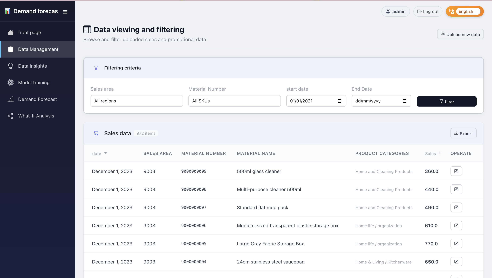
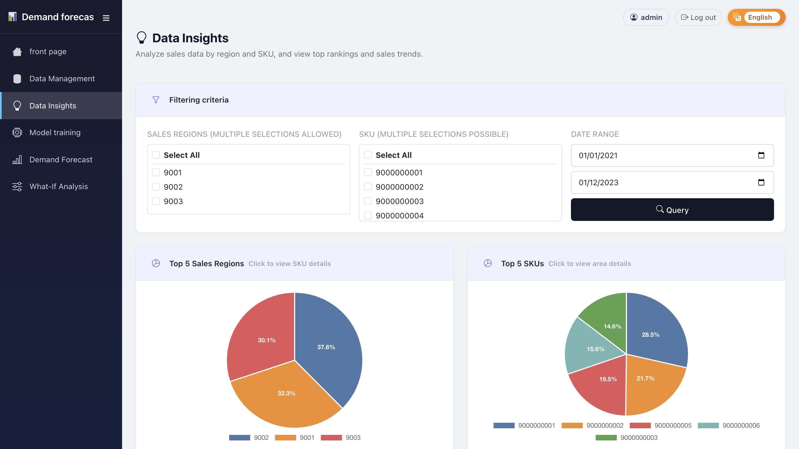
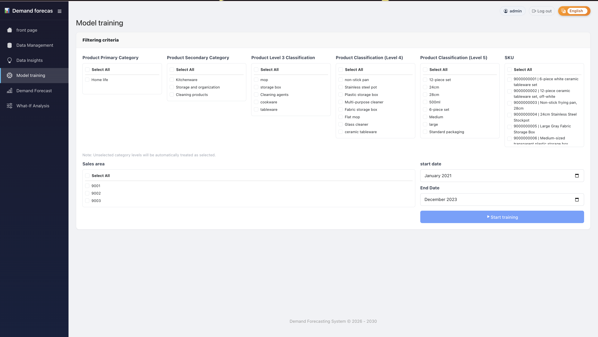
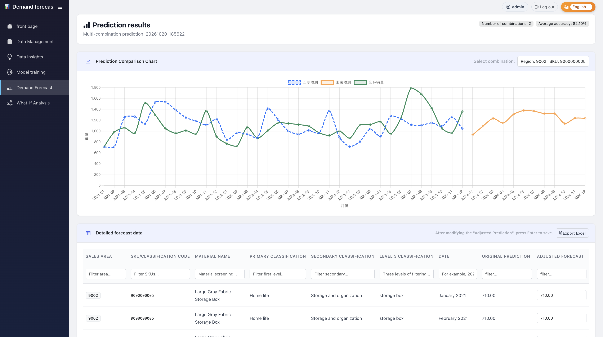
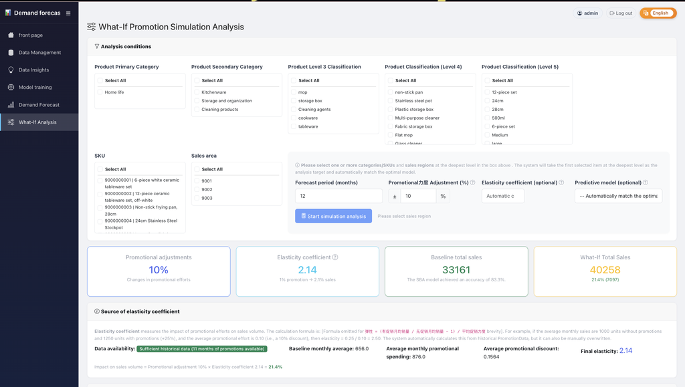

# Usage guide

A typical session follows five steps: import data → explore → train → forecast
→ simulate. Every page except the login page requires authentication.

## 1. Data Management (`/data/`)

### Upload

* `/data/upload/` accepts sales and promotion files in `.xlsx` format (≤ 10 MB).
* Download the templates from the same page and keep the column names unchanged.
* After the upload the data is cleaned automatically: duplicates are dropped,
  missing sales quantities become `0`, negative values are clipped and dates are
  parsed as `YYYY-MM-DD`.
* Product master data (`物料号` + `物料名称` + five category levels) is created
  on the fly when a new material number appears.

### Browse, adjust, export

* `/data/view/` — filter by region, SKU and date range, then export the current
  selection to Excel.
* `/data/adjust/` — edit the most recent sales and promotion records inline.
  A forecast value can also be overridden from the forecast result page.

## 2. Data Insight (`/insight/`)

* Pick one or more regions and SKUs, choose a date range and press **Search**.
* Two pie charts show the Top-5 regions and Top-5 SKUs; clicking a slice opens
  the corresponding detail breakdown.
* The line chart shows the sales trend of a selected material with a yearly,
  quarterly, monthly or weekly granularity.

## 3. Model Training (`/model/`)

1. Select the product hierarchy level (category level 1–5 or SKU) and the target
   items, then select at least one sales region. Unchecked levels mean "all".
2. Press **Start training**. For every region × item combination the system
   trains each available algorithm, evaluates it on the last three months, discards
   overfitted models (retrying with simpler parameters) and keeps the best one.
   When two or more models succeed they are also blended and compared.
3. `/model/results/` lists the stored models with accuracy, MAE/RMSE and the
   forecast-vs-actual chart.

Training is also triggered automatically when a forecast is requested and no
model exists yet.

## 4. Demand Forecast (`/forecast/`)

1. Choose the hierarchy level, the items and the regions, then the horizon
   (1–24 months, default 12).
2. Model mode:
   * **Auto match** — pick the best trained model for each combination.
   * **Manual** — select a specific model from the list (use **Refresh** to reload).
3. The result page (`/forecast/results/`) shows:
   * a comparison chart of the selected combinations,
   * a detailed table with actual / forecast / adjusted forecast values,
   * inline editing: click a forecast value, type a new one and press Enter.
4. Use **Export to Excel** to download the table.

A forecast can be saved as a *scenario* and reloaded later from
`/forecast/scenario/<id>/`.

## 5. What-If Analysis (`/forecast/what-if/`)

* Select the deepest selected category level or SKU plus the regions.
* Set **Promotion adjustment** (e.g. `+10` means invest 10 % more than today).
* Leave **Elasticity** empty to derive it from history, or enter a value
  manually (see the "elasticity source" panel for the formula and data coverage).
* The result shows baseline total sales, What-If total sales, the month-by-month
  comparison chart and the affected regions.

## Language switch

The selector at the bottom of the sidebar (or on the login page) switches the UI
between English and Simplified Chinese. The choice is stored in the
`django_language` cookie, so it survives navigation and new sessions.
See [i18n.md](i18n.md) for details.

## Tips

* Train per region: demand patterns of different regions rarely share a model.
* At least ~24 months of history is recommended; seasonal algorithms need two
  full seasonal cycles to work well.
* Intermittent demand (many zero months) benefits from `croston` / `sba`.
* Always sanity-check the adjusted forecast before exporting it to downstream
  systems.
